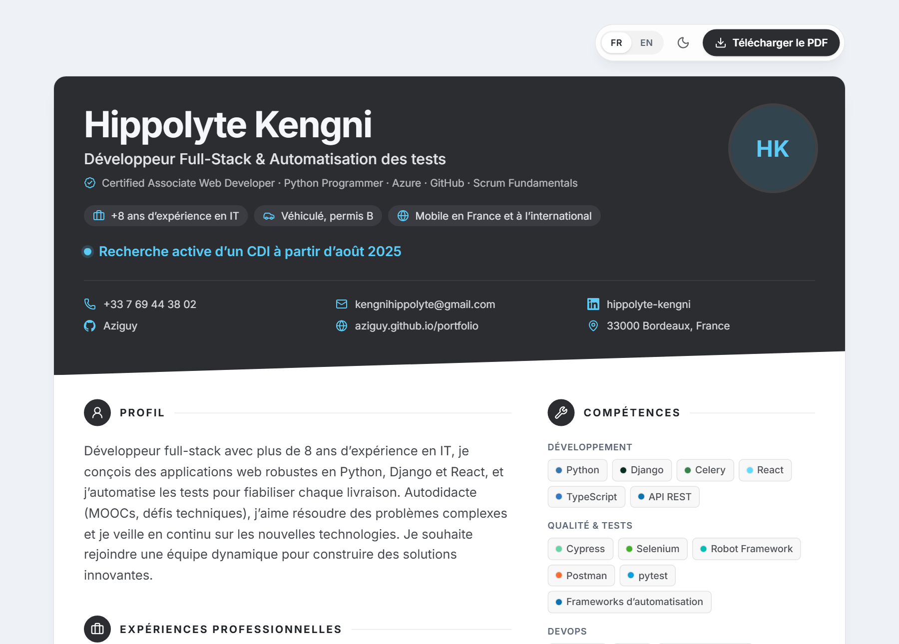

<div align="center">

# Interactive Resume Template

**Un CV web bilingue, élégant et imprimable, piloté par un seul fichier de configuration.**
Le PDF A4 est généré automatiquement à chaque build, toujours synchrone avec la version en ligne.

[](https://github.com/Aziguy/interactive-resume-template/actions/workflows/deploy.yml)


[](./LICENSE)

[**Voir le CV en ligne**](https://aziguy.github.io/interactive-resume-template/) ·
[PDF français](https://aziguy.github.io/interactive-resume-template/cv/fr/CV_Hippolyte_Kengni_FR.pdf) ·
[PDF anglais](https://aziguy.github.io/interactive-resume-template/cv/en/CV_Hippolyte_Kengni_EN.pdf)



</div>

## Points forts

| | |
|---|---|
| **Un seul fichier** | Tout le contenu vit dans [`src/config/resume.ts`](./src/config/resume.ts), typé et autocomplété. |
| **PDF automatique** | Playwright imprime le site en A4, une version par langue, servie par le bouton *Télécharger le PDF*. |
| **Bilingue** | FR / EN intégrés, langue détectée (URL `?lang=`, navigateur, dernier choix). Ajoutez autant de langues que nécessaire. |
| **Clair / sombre** | Thème système ou manuel, sans flash au chargement. 7 palettes prêtes à l'emploi. |
| **Mise en page aérée** | En-tête contrasté, deux colonnes, frise des expériences, durées calculées automatiquement. |
| **SEO & ATS** | Méta Open Graph, JSON-LD `schema.org/Person`, version HTML complète sans JavaScript, PDF balisé. |
| **Robuste** | Validation de la config au build (traductions manquantes, dates, ids, icônes), repli sur l'impression si le PDF manque. |
| **Léger** | Pas de librairie d'animation : transitions CSS, icônes Lucide tree-shakées, police Inter embarquée. |

## Démarrage rapide

Prérequis : Node.js 20.19+ (22 recommandé).

```bash
git clone https://github.com/Aziguy/interactive-resume-template.git
cd interactive-resume-template
npm install
npm run pdf:setup   # une seule fois : télécharge Chromium pour la génération PDF
npm run dev         # http://localhost:5173/interactive-resume-template/
```

En développement, le bouton PDF ouvre la boîte d'impression du navigateur. Pour obtenir les vrais fichiers :

```bash
npm run build       # site + PDF dans dist/ (dist/cv/<langue>/*.pdf)
npm run preview
```

## Personnaliser

Remplacez le contenu de [`src/config/resume.ts`](./src/config/resume.ts). Un modèle commenté se trouve dans [`resume.example.ts`](./src/config/resume.example.ts).

```ts
export const resumeConfig: ResumeConfig = {
  i18n: { default: 'fr', available: ['fr', 'en'] },
  personal: {
    name: 'Jane Doe',
    title: { fr: 'Développeuse Full-Stack', en: 'Full-Stack Developer' },
    availability: { fr: 'Disponible immédiatement', en: 'Available now' },
  },
  experiences: [
    {
      id: 'acme',
      role: { fr: 'Lead développeuse', en: 'Lead developer' },
      company: 'Acme',
      period: { start: '2022-03', end: 'present' },
      highlights: { fr: ['...'], en: ['...'] },
      techs: ['React', 'TypeScript'],
    },
  ],
  // education, skills, languages, interests, projects, seo, theme...
}
```

- **Photo** : déposez une image dans `public/images/` (détectée automatiquement), sinon vos initiales s'affichent.
- **PDF fait main** : un fichier dans `public/cv/<langue>/` remplace la génération automatique pour cette langue.
- **Thème** : `theme.preset` parmi `azure`, `minimal`, `warm`, `ocean`, `forest`, `slate`, `lilac`, chaque couleur reste surchargeable.

Le guide complet est dans [docs/CUSTOMIZATION.md](./docs/CUSTOMIZATION.md). Pas développeur ? Suivez [docs/GUIDE.md](./docs/GUIDE.md) ou laissez une IA remplir la config avec [docs/PROMPT-IA.md](./docs/PROMPT-IA.md).

## Déploiement

Le workflow [`deploy.yml`](./.github/workflows/deploy.yml) vérifie le lint, installe Chromium, construit le site avec ses PDF et publie sur **GitHub Pages** à chaque push sur `main` (Settings > Pages > Source : *GitHub Actions*). Le chemin de base s'adapte au nom du dépôt. Vercel, Netlify et autres hébergeurs statiques : voir [docs/DEPLOYMENT.md](./docs/DEPLOYMENT.md).

## Scripts

| Commande | Rôle |
|---|---|
| `npm run dev` | Serveur de développement |
| `npm run build` | Typecheck, build et génération des PDF |
| `npm run build:fast` | Build sans PDF |
| `npm run preview` | Sert le dossier `dist/` |
| `npm run lint` / `npm run typecheck` | Qualité du code |
| `npm run pdf:setup` | Installe Chromium pour Playwright |

Variable `RESUME_PDF=false` : désactive la génération PDF. En CI (`CI=true`), un échec de génération fait échouer le build.

## Architecture

```
build/                  Plugins Vite (exécutés au build)
├── plugins/assets.ts     détection photo et PDF dans public/
├── plugins/validate.ts   vérification de la configuration
├── plugins/html.ts       méta SEO, JSON-LD, thème initial, version sans JS
├── plugins/pdf.ts        impression A4 par langue avec Playwright
└── shared.ts
src/
├── config/             resume.ts (vos données), resume.example.ts
├── components/
│   ├── resume/           en-tête, sections, expériences
│   ├── toolbar/          langue, thème, bouton PDF
│   └── ui/               icônes, badges
├── data/               palettes, couleurs des technologies
├── lib/
│   ├── i18n/             textes intégrés FR/EN, fournisseur de langue
│   ├── theme/            fournisseur de thème, variables CSS
│   └── resume.ts         dates, durées, noms de fichiers (partagé navigateur / Node)
└── types/resume.ts     schéma de configuration
```

La logique partagée (`lib/resume.ts`, `lib/theme/css.ts`, `lib/i18n/messages.ts`) est sans dépendance au navigateur : elle sert à la fois à l'application et aux plugins de build, ce qui garantit un rendu identique entre le site, la version sans JavaScript et le PDF.

## SEO et ATS

Les ATS lisent surtout des PDF : le PDF généré est balisé (texte sélectionnable, signets) et reprend exactement le contenu en ligne. Côté web, le HTML statique contient déjà titre, description, Open Graph, JSON-LD et le CV complet dans un bloc `<noscript>` pour les robots. Partagez un lien direct dans la bonne langue avec `?lang=en`.

## Crédits

Basé sur [interactive-resume-template](https://github.com/clementbouly/interactive-resume-template) de Clément Bouly, refondu et étendu par [Hippolyte Kengni](https://github.com/Aziguy). Contributions bienvenues, voir [CONTRIBUTING.md](./CONTRIBUTING.md).

## Licence

[MIT](./LICENSE)
